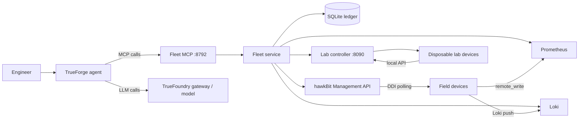
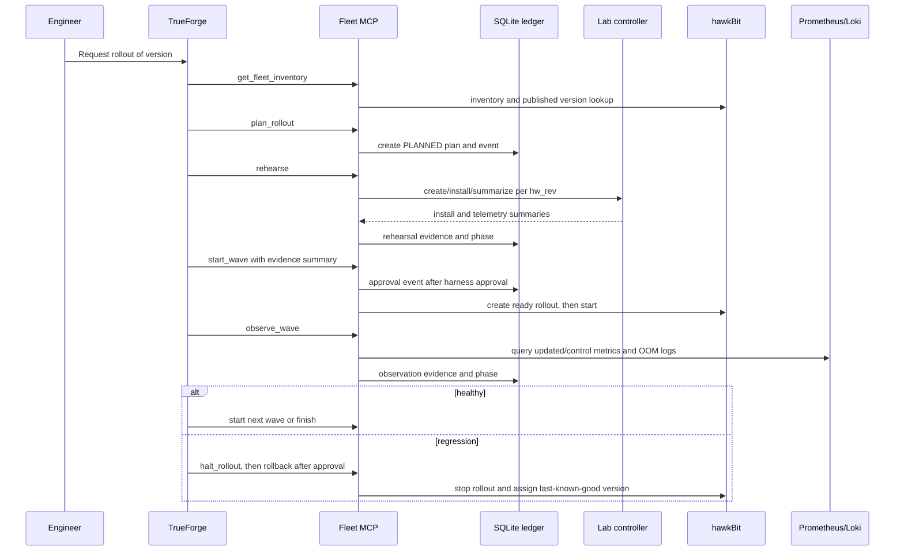

# Wavebreak technical interview dossier

Scope: repository root. Review performed read-only on 2026-10-21. Existing project files were not modified; this dossier is the requested addition under `interview-prep/`.

## Evidence convention

Every technical assertion below is tagged. `[CODE]` means the implementation or test directly supports it. `[DOC]` means it is stated in documentation/status and may be a demo claim. `[INFERRED]` is a reasoned conclusion that should be phrased as such in an interview. Citations use repository paths and line numbers where useful, or documented section numbers when the source is a design document.

## Step 1 — Inventory

### Repository map

```text
.
├── agent/                     TrueForge registration, driver, MCP server, tests
│   ├── fleet_mcp/              Fleet tools, business logic, evidence gates, ledger
│   ├── tests/                  Driver/registration tests
│   ├── spike/                  TrueForge probes and local runtime startup
│   └── smoke/                  Real-lab rehearsal smoke script
├── docs/                      Architecture, agent design, demo and deployment docs
│   ├── architecture.md
│   ├── agent-design.md
│   ├── DEMO.md
│   ├── aws-deploy.md
│   └── IMPLEMENTATION.md
├── infra/aws/                 EC2 install script and systemd services
├── lab/controller/             FastAPI controller for disposable lab devices
├── platform/                  Docker Compose and Prometheus/Loki/Grafana config
├── sim/
│   ├── device/                 Debian/systemd device image and telemetry units
│   ├── ota-agent/              Python stdlib OTA client and A/B installer
│   ├── inference-app/          App source and tests
│   ├── bundles/v1.0-v1.4/      Release artifacts, including real fault variants
│   ├── fleet/                  Fleet definition and container launcher
│   └── runtime/firecracker/    Fetch helper only; runtime is not implemented
├── wavebreak_clients/          stdlib HTTP clients for hawkBit/Prometheus/Loki
├── scripts/                    Build, publish, seed, demo, AWS sync and checks
├── Makefile                    Local orchestration entry points
├── pyproject.toml              Ruff and pytest configuration
└── AGENTS.md / CLAUDE.md       Project context and coding-agent instructions
```

`[CODE]` The repository contains Python, Bash, YAML, JSON, Dockerfiles, systemd units, Fluent Bit config, and Mermaid/Markdown documentation. The main Python components are `agent/fleet_mcp`, `sim/ota-agent/ota_agent`, `lab/controller/app.py`, and `wavebreak_clients`; the Makefile is the top-level build/run interface (`Makefile:1-91`).

`[CODE]` Entry points are `python -m agent.fleet_mcp` through `agent/fleet_mcp/__main__.py`, `agent/register.py`, `agent/driver.py`, `agent/start_fleet_mcp.sh`, `lab/controller/app.py` through Uvicorn/Compose, `sim/ota-agent/ota_agent/__main__.py`, `sim/fleet/fleetctl.py`, and the shell targets in `Makefile:19-91`.

`[CODE]` Runtime services are hawkBit, Prometheus, Loki, Grafana, optional mcp-grafana, the lab controller, field device containers, TrueForge, and the host-process Fleet MCP server. The Compose service definitions are in `platform/docker-compose.yml`; persistent state for rollout decisions is a local SQLite file initialized by `Ledger` (`agent/fleet_mcp/ledger.py:121-153`).

`[CODE]` Tests exist for the Fleet MCP modules, OTA DDI/local/install behavior, inference-app behavior, and observability clients. `Makefile:82-89` runs the listed pytest directories and Ruff/ShellCheck/Compose validation. There is no CI workflow under `.github/` in the repository inventory.

`[DOC]` The README reports 500 tests across four suites and describes local lite and AWS full profiles (`README.md:81-103`). Treat the count as a repository status claim, not as a result independently rerun for this dossier.

### Languages, frameworks, and build tools

| Area | Evidence | Interview interpretation |
|---|---|---|
| Python | `[CODE]` Python modules across `agent/`, `lab/`, `sim/`, and `wavebreak_clients/` | Main implementation language; stdlib is deliberately used in the OTA client and thin HTTP clients. |
| FastMCP/MCP | `[CODE]` `FastMCP` and `ToolError` imports in `agent/fleet_mcp/server.py:16-18` | Agent-facing tool protocol; the MCP layer is intentionally thin over `Fleet`. |
| FastAPI/Uvicorn | `[CODE]` FastAPI route functions in `lab/controller/app.py:43-324`; Compose builds the controller | Small internal REST API for lab lifecycle and device proxying. |
| Docker/systemd | `[CODE]` `sim/device/Dockerfile`, systemd units, and Compose | Reproduces Linux service lifecycle and cgroup behavior in containers. |
| Prometheus/Loki/Grafana/Fluent Bit | `[CODE]` `PromBackend` and `wavebreak_clients/observability.py`; platform config | Metrics and logs are queryable control data, not only dashboard output. |
| Eclipse hawkBit | `[CODE]` `HawkbitClient` and `HawkbitBackend` | Real OTA control plane and DDI device protocol. |
| SQLite | `[CODE]` `rollouts` and `events` schema in `agent/fleet_mcp/ledger.py:32-50` | Local durable state and audit trail; simple, transactional, single-host. |
| Make/ShellCheck/Ruff/pytest | `[CODE]` `Makefile:44-91`, `pyproject.toml:1-7` | Reproducible developer workflow, linting and tests. |
| TrueFoundry/TrueForge | `[DOC]` `README.md:61-76`, `docs/agent-design.md:72-95` | LLM harness, sandbox, tool registration and approval orchestration. |

### Entry points and deployment files

- `[CODE]` `Makefile` targets: `up`, `down`, `bundles`, `publish`, `fleet`, `lab`, `demo-reset`, `e2e`, `test`, and `lint` (`Makefile:19-91`).
- `[CODE]` `platform/docker-compose.yml`: backend and lab containers; `platform/prometheus/prometheus.yml`, `platform/loki/config.yaml`, and Grafana provisioning configure telemetry.
- `[CODE]` `infra/aws/install.sh` installs the checkout, generates/retains `.env` secrets, starts the full profile, installs Python dependencies, and enables `wavebreak-trueforge.service` and `wavebreak-fleet-mcp.service` (installation flow around `infra/aws/install.sh:91-117`, `145-221`, `250-256`).
- `[CODE]` `agent/spike/start_trueforge.sh` starts TrueForge; `agent/start_fleet_mcp.sh` starts the MCP server.
- `[CODE]` `sim/runtime/firecracker/fetch.sh` exists, but `[DOC]` `README.md:119-125` explicitly says Firecracker is not implemented.
- `[CODE]` No GitHub Actions, Terraform, Kubernetes manifests, database migration framework, OpenAPI document, or notebook was found.

### Document inventory

There is no `docs/adr/` directory. Design decisions are embedded in `docs/architecture.md` and `docs/agent-design.md` decision logs.

| Document | Technical summary and what it adds beyond code |
|---|---|
| `README.md` | `[DOC]` Product pitch, challenge mapping, demo scenes, stack, claimed results, runbook, and honest limitations. It gives system intent and reported outcomes that are not obvious from individual modules. |
| `AGENTS.md` | `[DOC]` Hackathon context, domain model, repo map, local/AWS profiles, resource constraints, workflow rules, and agent roles. It explains why the architecture optimizes for a 6–7 hour build and low local RAM. |
| `CLAUDE.md` | `[DOC]` Points tooling to `AGENTS.md`; contains little additional system design. |
| `docs/architecture.md` | `[DOC]` C4 context/container/component diagrams, interfaces, ports, data, fault catalogue, state machine, deployment, decisions, open questions, and drift report. It is the primary architecture source of truth. |
| `docs/agent-design.md` | `[DOC]` Agent design: controllables, MCP tool contracts, phase machine, evidence model, approvals, sandbox, prompt/instructions, demo scenes, decisions and sources. It states intended semantics and exposes known model/harness limitations. |
| `docs/DEMO.md` | `[DOC]` Human demo script, exact prompts, expected v1.2/v1.3/v1.4 outcomes, operator recovery if the model stops, and judge questions. Useful for separating verified demo behavior from general production claims. |
| `docs/aws-deploy.md` | `[DOC]` EC2 deployment runbook, SSH tunnel, security-group assumptions, update workflow, and a deployment log. It documents operational procedure but does not prove repeatable CI/CD. |
| `docs/IMPLEMENTATION.md` | `[DOC]` Overnight tracker with milestones, parked Firecracker/AWS work, human dependencies, and run log. It shows what was built under time constraints and what was intentionally left incomplete. |
| `docs/prompts/overnight.md` | `[DOC]` Autonomous overnight-loop instructions, subagent policy, verification rules, cost/RAM discipline, and parked work. It describes development process rather than runtime behavior. |
| `agent/STATUS.md` | `[DOC]` Final Scene 2 run details, token/cost/time report, changes, flaky-model notes, unverified rollback, and a previously fixed `awk` bug. It is useful evidence, but the metrics are historical status claims. |
| `agent/instructions.md` | `[DOC]` Agent workflow and safety instructions used to guide tool order and not invent health. |
| `agent/spike/README.md` | `[DOC]` Throwaway TrueForge verification setup and provider registration notes. |
| `.claude/agents/*.md` | `[DOC]` Roles for scaffolder, implementer, verifier, and researcher subagents; these explain development orchestration, not application runtime. |
| `LICENSE` | `[DOC]` MIT licensing. It does not define operational guarantees. |

### Explicit doc/code drift register

`[DOC]` The project’s own drift audit is `docs/architecture.md:958-997`. The following is the complete register, condensed so none of its findings are lost in this dossier:

| ID | Drift / unfinished area | Evidence and interview consequence |
|---|---|---|
| C1 | Partial rehearsal coverage could previously authorize an uncovered revision; the current code now requires plan-wide passing coverage. | `[DOC]` `docs/architecture.md:966`; verify current behavior in `agent/fleet_mcp/preconditions.py:139-165`. Explain the fix and retain coverage tests. |
| C2 | Partial rollback failures can still move the plan to `ROLLED_BACK`; failed devices are not automatically retried. | `[DOC]` `docs/architecture.md:967`; `[CODE]` `agent/fleet_mcp/fleet.py:866-905`. This is a real recovery-integrity gap. |
| C3 | The drift report says Loki OOM handling once failed open; current code raises `MetricsUnavailable` on Loki errors. | `[DOC]` historical drift at `docs/architecture.md:968`; `[CODE]` current path `agent/fleet_mcp/backends.py:319-334`. Do not describe the old bug as current without dating it. |
| C4 | Evidence freshness is checked before/around the action flow and may expire while approval is pending. | `[DOC]` `docs/architecture.md:969`; `[CODE]` `agent/fleet_mcp/fleet.py:635-662`. A slow human can receive a stale-evidence refusal. |
| C5 | MCP has no application authentication and approval is represented as harness trust. | `[DOC]` `docs/architecture.md:970`, `README.md:119-125`; this is unacceptable for remote/shared production deployment. |
| C6 | `plan_rollout` is write-capable but not approval-gated; hold freshness/latest checks and approval-card detail are limited. | `[DOC]` `docs/architecture.md:971`; `[CODE]` `agent/fleet_mcp/server.py:126-157`, `agent/fleet_mcp/preconditions.py:324-371`. |
| C7 | The sandbox is enabled but no separate `rollout-playbook` skill is registered; instructions are inline and provider pinning is absent. | `[DOC]` `docs/architecture.md:972`; `[CODE]` `agent/register.py:163-190`. |
| C8 | The “at most three inconclusive observations” rule exists only in instructions, not as a server-enforced counter. | `[DOC]` `docs/architecture.md:973`; `[CODE]` `agent/instructions.md:27`, no corresponding counter in `Fleet`. |
| C9 | Lab creation timeout can orphan a container; there is no global lab TTL/sweeper. | `[DOC]` `docs/architecture.md:974`; `[CODE]` cleanup only covers already-known IDs in `agent/fleet_mcp/fleet.py:504-617`. |
| C10 | Halt calls hawkBit stop, but the design’s claim that pending actions are cancelled is still marked unverified. | `[DOC]` `docs/architecture.md:975`; `[CODE]` `agent/fleet_mcp/backends.py:167-181`. |
| C11 | `observe_wave` and `verify_recovery` are annotated read-only although they write ledger evidence and phase changes. | `[DOC]` `docs/architecture.md:976`; `[CODE]` `agent/fleet_mcp/server.py:207-220`, `279-294`. |
| C12 | Inventory performs serial per-target calls and caps the target list at 500. | `[DOC]` `docs/architecture.md:977`; `[CODE]` `agent/fleet_mcp/backends.py:97-111`. |
| C-E1 | Demo reset became profile-aware, but full 20-device timing remains unverified. | `[DOC]` `docs/architecture.md:983`; `[DOC]` `docs/IMPLEMENTATION.md:134-141`. |
| C-E2 | Firecracker is parked: launcher rejects non-container runtime and only fetch/network helpers exist. | `[CODE]` `sim/fleet/fleetctl.py:68-71`; `[DOC]` `docs/architecture.md:984`. |
| C-E3 | Lab device HTTP errors, including device install 422, are mapped to controller 502, making the intended 422 path unreachable. | `[DOC]` `docs/architecture.md:985`; `[CODE]` `lab/controller/app.py:168-187`, `307-320`. |
| C-E4 | Field network exposes hawkBit, Prometheus lifecycle API and Loki without service auth. | `[CODE]` `platform/docker-compose.yml:39-65`, `101-128`; `[DOC]` `docs/architecture.md:986`. |
| C-E5 | Lab devices set `TELEMETRY=0`, so they do not produce normal Fluent Bit lab telemetry. | `[CODE]` `lab/controller/app.py:137-146`; `[DOC]` `docs/architecture.md:987`. |
| C-E6 | No `wavebreak_clients/lab.py`; `HttpLab` lives in `agent/fleet_mcp/backends.py`. | `[DOC]` `docs/architecture.md:988`; `[CODE]` `agent/fleet_mcp/backends.py:427-488`. |
| C-E7 | Observability docstring examples use `app=` labels that do not match the actual label scheme. | `[DOC]` `docs/architecture.md:989`; `[CODE]` actual query labels in `agent/fleet_mcp/backends.py:299-325`. |
| C-E8 | Target-token mode is half implemented with one shared token rather than per-target provisioning. | `[CODE]` `sim/fleet/fleetctl.py:89-93`; `[DOC]` `docs/architecture.md:990`. |
| C-E9 | `mcp-grafana` uses `latest` and its token may be empty; Fluent Bit package version is not pinned. | `[CODE]` `platform/docker-compose.yml:171-182`, `sim/device/Dockerfile:10-20`; `[DOC]` `docs/architecture.md:991`. |
| C-E10 | Dashboard version count counts time-series labels, not necessarily unique devices and can retain old-version series. | `[DOC]` `docs/architecture.md:992`; `[CODE]` `platform/grafana/dashboards/wavebreak-fleet.json:1-73`. |
| C-E11 | `.env.example` contains dead variables and omits several used variables. | `[DOC]` `docs/architecture.md:993`; `[CODE]` consumers include `Makefile:1-17`, `agent/fleet_mcp/config.py:56-90`, and `platform/docker-compose.yml:39-182`. |
| C-E12 | `make test` includes wildcard directories with no tests and `hawkbit.py` lacks dedicated client tests. | `[CODE]` `Makefile:82-84`; `[DOC]` `docs/architecture.md:994`. |
| C-E13 | Full profile permits an empty MySQL root password and docs mention a MariaDB/JDBC configuration mismatch. | `[CODE]` `platform/docker-compose.yml:23-37`, `platform/hawkbit/full.env:1-`; `[DOC]` `docs/architecture.md:995`. |
| C-E14 | Several fleet YAML values are unused (`hawkbit_poll_seconds`, VM fields, lab prefix). | `[DOC]` `docs/architecture.md:996`; `[CODE]` `sim/fleet/fleet.yaml`, `sim/fleet/fleetctl.py:39-105`. |

## 1. Pitch

### 30-second version

I built Wavebreak, an AI-assisted rollout manager for Linux edge-camera fleets. The core problem is that an OTA server can report installation success while a release later causes an OOM loop, memory leak, or delayed crash. Wavebreak plans hardware-stratified waves, rehearses a release on disposable lab devices, compares updated devices with same-revision controls using Prometheus and Loki, and exposes evidence-gated actions through a Python MCP server. `start_wave`, `halt_rollout`, and `rollback` require fresh evidence plus human approval; decisions and evidence are recorded in SQLite. `[CODE]` `agent/fleet_mcp/server.py:31-37`, `agent/fleet_mcp/fleet.py:504-675`, `agent/fleet_mcp/ledger.py:32-50`.

### 2-minute version

The system has three important planes. The device plane is a Debian/systemd container running an inference app, a Python OTA agent, node_exporter, and Fluent Bit. The OTA agent downloads a hawkBit artifact, validates its SHA-256 and manifest, stages it in the inactive A/B slot, atomically flips `current`, restarts the app, and requires an active unit, no restart, and advancing `frames_total` during the health window. `[CODE]` `sim/ota-agent/ota_agent/install.py:138-184`, `283-321`, `325-378`.

The control plane is a `Fleet` service behind FastMCP. `plan_rollout` snapshots eligible inventory and creates deterministic hardware/region/version-stratified waves. `rehearse` creates one disposable lab device per hardware revision, installs the target version, polls summaries, computes a least-squares memory slope and checks restarts/OOM/unit state, then destroys the lab devices. `[CODE]` `agent/fleet_mcp/fleet.py:366-474`, `504-617`; `agent/fleet_mcp/assess.py:14-25`, `215-261`.

After rehearsal, the agent can start a hawkBit rollout only if the evidence has the right kind, version, wave, hardware coverage, passing verdict, and freshness. Observation waits for a soak window, queries install failures and telemetry, and compares updated devices to same-hardware controls or a pre-update baseline. Any regression signal wins; missing data or unavailable Prometheus/Loki is `inconclusive`, not healthy. `[CODE]` `agent/fleet_mcp/preconditions.py:50-137`; `agent/fleet_mcp/fleet.py:679-821`; `agent/fleet_mcp/assess.py:107-177`.

The design is intentionally conservative but not production-complete. The MCP server binds to localhost and has no application authentication, the ledger is a local SQLite database, model behavior can stop mid-flow, rehearsal windows are short, and rollback is unit-tested against mocks rather than validated live. `[DOC]` `README.md:119-125`; `agent/STATUS.md:18-32`; `[CODE]` `agent/fleet_mcp/config.py:76-99`.

## 2. Problem & context

### Problem solved

`[DOC]` The stated failure mode is a release that installs successfully but later leaks memory, OOM-kills, or enters a delayed crash loop that hawkBit’s install thresholds do not detect (`README.md:12-20`; `docs/architecture.md:58-76`). `[CODE]` The repository contains actual fault bundles: v1.2/v1.3 application variants and tests in `sim/bundles/` and `sim/inference-app/tests/`.

### Users and constraints

- `[DOC]` Primary user: a fleet engineer who approves or denies rollout actions (`docs/architecture.md:78-102`).
- `[CODE]` Runtime action safety is enforced by both MCP destructive annotations and server preconditions (`agent/fleet_mcp/server.py:31-37`, `188-205`; `agent/fleet_mcp/preconditions.py:50-137`).
- `[CODE]` Evidence freshness defaults to 900 seconds, lab rehearsal to 5 minutes, observation to 4 minutes, polling to 15 seconds, and lab parallelism to 2 (`agent/fleet_mcp/config.py:87-99`).
- `[DOC]` Local operation is constrained to roughly 3.5 GB RAM and a four-device lite profile; full/AWS is documented as 20 devices (`AGENTS.md:87-101`, `README.md:89-103`). These are environment/demo configurations, not a demonstrated capacity limit.
- `[CODE]` No latency SLO, tenant isolation requirement, regulated-data requirement, formal RPO/RTO, or production traffic volume is defined in code. The only data model is device telemetry and rollout metadata; no PII schema is present.

### Likely role

`[INFERRED]` The code and docs suggest a staff/lead implementation role spanning domain modeling, Python service logic, integration clients, safety semantics, test design, deployment scripts, and documentation. The repository does not establish which files you personally wrote; answer that explicitly rather than claiming sole ownership.

## 3. Architecture

### Components and responsibilities

| Component | Responsibility | Evidence |
|---|---|---|
| TrueForge agent | LLM conversation, tool orchestration, sandbox and approval UX | `[DOC]` `docs/agent-design.md:72-95`, `386-412`; registration in `agent/register.py`. |
| Fleet MCP server | Exposes 11 tools, validates arguments, maps refusals to stable `ToolError`s | `[CODE]` `agent/fleet_mcp/server.py:97-296`. |
| `Fleet` | Business workflow, phase transitions, backend orchestration, evidence creation | `[CODE]` `agent/fleet_mcp/fleet.py:87-109`, `366-474`, `504-905`. |
| Preconditions | Phase/evidence/coverage/freshness/target checks | `[CODE]` `agent/fleet_mcp/preconditions.py:16-137`, `207-284`, `324-371`. |
| Assessment | Pure threshold rules for rehearsal and wave health | `[CODE]` `agent/fleet_mcp/assess.py:14-261`. |
| Ledger | SQLite plans plus append-only event/evidence records | `[CODE]` `agent/fleet_mcp/ledger.py:32-50`, `121-319`. |
| hawkBit backend | Inventory, rollout creation/start/stop, assignment and action status | `[CODE]` `agent/fleet_mcp/backends.py:81-223`. |
| Prom/Loki backend | Queries memory, FPS, restarts and OOM logs; normalizes per-device stats | `[CODE]` `agent/fleet_mcp/backends.py:280-358`. |
| Lab controller | Creates/disposes disposable devices, fetches bundles read-only, proxies local install/status | `[CODE]` `lab/controller/app.py:90-190`, `238-324`. |
| OTA agent | hawkBit DDI loop or local lab API plus shared installer | `[CODE]` `sim/ota-agent/ota_agent/ddi.py:66-251`; `install.py:187-378`. |
| Device | Inference service, cgroups/systemd, metrics and logs | `[CODE]` `sim/device/Dockerfile` and `sim/device/files/etc/systemd/system/`; `[DOC]` `docs/architecture.md:181-239`. |

### Data flow



`[CODE]` The wiring is in `agent/fleet_mcp/server.py:70-90`; device telemetry and lab boundaries are documented in `docs/architecture.md:104-177` and implemented by the backend/client files cited above.

### Main sequence



`[CODE]` The exact sequence is implemented in `Fleet.rehearse` (`fleet.py:504-553`), `Fleet.start_wave` (`635-675`), `Fleet.observe_wave` (`679-730`), `Fleet.halt_rollout`/`rollback` (`825-905`), with the phase guards in `preconditions.py`.

### Sync versus async boundaries

- `[CODE]` MCP tool wrappers for `rehearse`, `observe_wave`, and `verify_recovery` are `async`; synchronous actions call backends directly (`agent/fleet_mcp/server.py:159-218`, `279-294`).
- `[CODE]` The async operations are still blocking workflows from the caller’s perspective: they sleep/poll within the tool call, using cancellable chunks (`agent/fleet_mcp/fleet.py:132-139`, `607-610`, `679-685`).
- `[CODE]` Device-to-hawkBit DDI is polling, not a push callback (`sim/ota-agent/ota_agent/ddi.py:1-5`, `145-251`).
- `[INFERRED]` There is no queue or durable job worker. A process restart during an in-flight rehearsal/observation can lose in-memory progress even though earlier ledger events remain. The ledger is the recovery source for completed events, not a job scheduler.

## 4. Tech stack & why

| Component | Choice | Why chosen | Alternative | When alternative is better |
|---|---|---|---|---|
| Agent protocol | MCP/FastMCP | Typed tools and annotations map naturally to agent actions and approval gating (`server.py:16-37`) | REST/OpenAPI/function calling | REST is better for non-agent clients or public service integration; direct function calling is simpler inside one hosted agent. |
| Agent runtime | TrueForge | Provides tool orchestration, sandbox and human approval integration (`docs/agent-design.md:72-95`) | LangGraph, Temporal, custom state machine | LangGraph/Temporal become preferable when workflow durability, retries, and explicit graph execution matter more than hackathon integration. |
| LLM access | TrueFoundry gateway with OpenAI-compatible model; Gemini fallback | Central provider configuration and gateway integration are documented (`agent/STATUS.md:3-16`) | Direct model APIs, self-hosted model | Direct APIs reduce gateway dependency; self-hosting helps privacy/cost at sustained volume but increases operations. |
| Workflow state | SQLite | Zero-ops local durable ledger, transactional writes, WAL (`ledger.py:121-153`) | Postgres | Postgres is better for multiple MCP replicas, concurrent operators, indexes, backups, and HA. |
| OTA control | Eclipse hawkBit | Real device-management and rollout semantics, including DDI (`wavebreak_clients/hawkbit.py:18-301`) | Mender, balena, custom service | Alternatives win if their fleet identity, staged rollout, device auth, or cloud operations better match a real fleet. |
| Lab API | FastAPI | Small typed internal HTTP API and easy Docker integration (`lab/controller/app.py:43-324`) | gRPC, direct Docker API | gRPC helps high-volume typed RPC; a job system helps long-running lab provisioning and retries. |
| Metrics | Prometheus | Range queries and label-based per-device comparison (`observability.py:435-514`) | OpenTelemetry metrics, managed TSDB | Managed TSDB is better for HA/retention; OTel is better when standardizing instrumentation across vendors. |
| Logs | Loki | LogQL and labels provide OOM-kill evidence (`observability.py:516-604`) | Elasticsearch/OpenSearch | Search-heavy, long-retention, full-text workloads favor OpenSearch; Loki is cheaper/simple for label-oriented logs. |
| Device runtime | Docker containers with systemd | Reproduces Linux service/cgroup behavior on constrained local hardware (`sim/device/Dockerfile`) | Firecracker/Kubernetes | Firecracker gives stronger VM isolation; Kubernetes helps fleet orchestration but is excessive for four local devices. |
| OTA installation | Python stdlib, A/B slots | Few dependencies, atomic symlink switch, local rollback (`install.py:138-184`, `238-378`) | RAUC, OSTree, Mender client | A mature image/update framework is better for signed full images, bootloader integration, delta updates, and fleet-grade recovery. |
| HTTP clients | Python stdlib | Keeps thin clients small and dependency-light (`wavebreak_clients/_http.py:71-153`) | httpx/requests | A maintained HTTP library is better for connection pooling, async I/O, retry middleware, TLS features, and observability. |
| Device state | systemd units and files | Matches target Linux operational model; systemd owns restart/health semantics | Kubernetes sidecars or supervisor | Kubernetes is better at orchestrating hosts, but less representative of the device OS model. |
| Test strategy | pytest plus pure assessment tests | Pure threshold logic is deterministic; injected clocks/backends avoid real waiting (`fleet.py:1-5`) | Full simulator/e2e only | Contract and fault-injection tests are needed for external API drift and live rollback confidence. |

## 5. Key decisions & trade-offs

| # | Decision | Context | Options considered | Why this one | Cost/trade-off | What would make me change it |
|---|---|---|---|---|---|---|
| 1 | Store rollout state in SQLite with JSON plan blobs and an event table | Need durable evidence/audit quickly | In-memory state, Postgres, event store | WAL, transactions and zero external DB make the demo reproducible (`ledger.py:32-50`, `121-153`) | Single-host, weak queryability of JSON, no HA/replication | Second operator, multiple replicas, or required RPO/HA → Postgres with normalized schema. |
| 2 | Treat actions as a phase machine | Tool order must be safe under model mistakes | Prompt-only rules, database constraints, workflow engine | Server-side phase/evidence checks cannot be bypassed by a prompt (`preconditions.py:27-89`) | Many refusal branches and state-transition complexity | More workflows/long-running jobs → explicit workflow engine or formal transition table. |
| 3 | Require fresh, plan-specific evidence | Stale or cross-plan evidence can authorize the wrong action | Trust model prose, latest evidence globally | `check_evidence` validates kind, plan, wave, verdict and age (`preconditions.py:50-89`) | Evidence IDs and state make tool calls verbose | Need cross-plan reusable evidence or very large history → indexed evidence service with signed artifacts. |
| 4 | Fail closed on missing telemetry | Missing data must not become “healthy” | Best-effort health, fail open | `MetricsUnavailable` and missing samples produce `inconclusive` (`backends.py:288-334`; `assess.py:146-164`) | Outages pause rollouts and can create operator toil | Define bounded degraded-mode policy with independent health signals and explicit approval. |
| 5 | Stratify waves by hardware revision by default | Fault v1.2 only affects rev B | Random canary, region-only, all-at-once | Planner cycles strata and records warnings (`agent/fleet_mcp/planner.py:34-71`) | Small waves may not contain every stratum; distribution is not statistically optimized | Fleet size/heterogeneity grows → cohort allocation service and minimum sample policy. |
| 6 | Use same-revision controls, then pre-update baseline | Absolute thresholds are noisy across hardware | Global threshold, only baseline | `Fleet._assess_hw_rev_metrics` prefers controls and falls back to a 600-second baseline (`fleet.py:772-797`) | Control contamination and baseline retention issues | Need causal confidence → persistent cohort assignment and experiment/statistical analysis. |
| 7 | Keep model outside the safety boundary | LLM proposes actions; server validates them | Let LLM decide directly, hard-coded workflow only | MCP tools refuse invalid evidence and harness gates destructive tools (`server.py:188-205`; `preconditions.py`) | More engineering than prompt-only agents; model may still stop mid-flow | If workflows become fully deterministic, remove LLM from execution path or use it only for explanation. |
| 8 | Human approval by destructive tool name | Rollout/rollback changes real devices | Approval after a textual plan, no approval | TrueForge registration and MCP destructive annotations make approval explicit (`server.py:31-37`; `[DOC]` `docs/agent-design.md:295-317`) | Approval UX/harness coupling; automated operation is slower | Define risk tiers and policy engine for different environments/cohorts. |
| 9 | A/B slot install with atomic symlink flip | Need local recovery before field rollback | In-place overwrite, full image/bootloader update | `Installer._flip`, manifest validation and local rollback are simple and testable (`install.py:238-260`, `341-378`) | Not a signed bootable image; app-only update and filesystem assumptions | Hardware fleet needs boot recovery, signatures or delta images → RAUC/OSTree/Mender. |
| 10 | Short synchronous polling windows | Hackathon demo and limited local RAM | Background jobs, streaming, long soak | Easy to reason about and injected clocks make tests fast (`fleet.py:132-139`, `563-617`) | Tool call duration, cancellation/restart risk, later faults missed | Production operation → durable jobs, callbacks/events, persisted checkpoints and configurable soak policy. |
| 11 | Localhost MCP with no auth | Intended host-local agent integration | OAuth/mTLS/service mesh | Small attack surface if truly localhost and harness is trusted (`config.py:87-90`; `[DOC]` `README.md:119-125`) | Root/systemd deployment and misbinding could expose destructive tools | Any remote access or shared host → mTLS/OIDC, RBAC, network policy, audit identity. |
| 12 | Thin stdlib HTTP clients | Minimize dependency footprint | httpx/requests SDKs | Small surface and explicit request behavior (`_http.py:71-153`) | No pooling/retry/tracing middleware; HTTP edge cases are hand-implemented | Higher QPS or more complex auth/TLS/retries → httpx with a tested transport layer. |
| 13 | Store evidence payloads as JSON | Payload varies by evidence kind | Fully normalized metric tables, object store | Fast schema evolution for prototype (`ledger.py:42-50`, `272-284`) | Hard to query/index, schema drift, potentially large rows | Compliance/reporting/large history → immutable evidence objects plus relational metadata and hashes. |
| 14 | Use model-generated root-cause hints, not automatic diagnosis | Bundle diff can aid investigation | Static diff only, autonomous remediation | `get_bundle_diff` is read-only and action gates remain server-side (`server.py:176-186`) | Hints can be wrong and there is no measured diagnostic accuracy | Add labeled fault dataset and evaluate precision/recall before trusting recommendations. |
| 15 | Containerized device simulation rather than Firecracker | Local reproducibility and time/RAM constraints | Firecracker, hardware-in-loop | Real systemd/cgroup/telemetry behavior is available quickly (`sim/device/`; `[DOC]` `docs/IMPLEMENTATION.md:80-103`) | Weaker isolation and not representative of kernel/VM failure modes | Security boundary or kernel-level behavior matters → implement and validate Firecracker path. |

## 6. Deep dives

### Data model

`[CODE]` `rollouts` has `plan_id` primary key, target `version`, `from_version`, serialized `waves_json`, phase, and timestamps. `events` has an autoincrement ID, plan ID, timestamp, type, optional wave/evidence ID, and serialized payload (`agent/fleet_mcp/ledger.py:32-50`). `Plan` materializes waves, device metadata, phase, and held cohorts (`ledger.py:63-78`).

`[CODE]` Evidence is an event with a random `ev-<8 hex>` ID; the payload carries the verdict and per-hardware details (`ledger.py:272-301`). Approval, action, decision, hold, error, rehearsal, observation, and verification are event types (`ledger.py:16-30`).

`[CODE]` There are no explicit SQL indexes besides primary keys; lookups filter `plan_id`, `type`, `evidence_id`, and phase (`ledger.py:198-221`, `292-319`). At current demo scale this is adequate. `[INFERRED]` At large event history, `events(plan_id,type)` and `events(evidence_id)` indexes would be obvious first additions.

`[CODE]` There is no migration versioning: initialization is `CREATE TABLE IF NOT EXISTS` only (`ledger.py:32-50`, `121-133`). Existing JSON blobs have no schema version. This is a production data-integrity gap.

### APIs and interfaces

#### MCP tools

`[CODE]` The server exposes inventory/state reads, planning, rehearsal, bundle diff, wave start, observation, decision recording, halt, rollback, and recovery verification (`server.py:101-294`). It uses Pydantic `Field` annotations for descriptions and minimum evidence-summary length (`server.py:39-67`).

`[CODE]` There is no HTTP versioning or pagination in the MCP contract. Inventory and device/event outputs are capped in application code at 100 devices or 50 list entries (`fleet.py:40-70`, `161-180`, `321-339`). This avoids huge model context but silently truncates unless the response includes a count.

`[CODE]` Refusal errors are stable strings containing codes such as `BAD_PHASE`, `EVIDENCE_STALE`, `EVIDENCE_WRONG_PLAN`, `REHEARSAL_COVERAGE`, and `TARGET_NOT_ELIGIBLE` (`preconditions.py:16-48`, `50-137`, `207-284`). Backend exceptions are converted into `BACKEND_ERROR` ledger errors by `_call` (`fleet.py:116-130`).

#### Lab HTTP API

`[CODE]` The lab controller has `/healthz`, `POST /lab/devices`, `GET /lab/devices`, `GET /lab/devices/{id}/summary`, `POST /lab/devices/{id}/install`, and `DELETE /lab/devices/{id}` (`lab/controller/app.py:266-328`). It protects routes with a bearer token (`app.py:49-54`), but the controller owns Docker access and is the only service with the Docker socket per the architecture doc (`docs/architecture.md:240-261`).

#### hawkBit and telemetry clients

`[CODE]` `HawkbitClient` builds Management API calls for targets, distribution sets, rollouts and assignments (`wavebreak_clients/hawkbit.py:18-301`). Prometheus and Loki wrappers normalize query response status and expose range/instant query methods (`wavebreak_clients/observability.py:412-604`).

#### Idempotency/versioning

`[CODE]` The OTA client treats an assigned version already installed as success according to the DDI flow described in `sim/ota-agent/ota_agent/ddi.py`; the server’s destructive MCP annotations explicitly mark `idempotentHint=False` (`server.py:35-37`). There is no general request idempotency key, API version, or distributed deduplication mechanism. `[INFERRED]` Repeated model calls can create duplicate planning attempts only where phase checks allow or supersede them; repeated field assignment/rollout calls need live hawkBit behavior to establish safety.

### Concurrency & consistency

`[CODE]` Ledger writes use a fresh SQLite connection, WAL, and `BEGIN IMMEDIATE`, committing or rolling back the transaction (`ledger.py:121-153`). This serializes competing writers on one database file and makes individual plan/event writes atomic.

`[CODE]` An install lock uses `fcntl.flock(LOCK_EX|LOCK_NB)` to reject concurrent local installs (`install.py:325-335`). A/B flip uses a temporary symlink plus `os.replace`, which avoids a partially-written `current` pointer (`install.py:238-243`).

`[CODE]` Rollout start is not one distributed transaction: the server records approval, calls hawkBit, records the action, then changes the phase (`fleet.py:635-662`). If hawkBit succeeds but the process dies before the ledger action/phase write, the external rollout and local state can diverge. `[INFERRED]` Reconciliation is therefore required for production.

`[CODE]` Wave ordering is enforced by preconditions and the phase machine; waves are separate hawkBit rollouts and are started explicitly (`preconditions.py:139-185`; `backends.py:134-150`).

### Failure handling

- `[CODE]` Backend calls are wrapped and recorded as error events; `MetricsUnavailable` is allowed to become inconclusive evidence rather than a healthy result (`fleet.py:116-130`, `732-753`).
- `[CODE]` Prometheus/Loki query failures raise `MetricsUnavailable`; empty device series yield `installed=False`, which leads to inconclusive assessment (`backends.py:288-358`; `assess.py:146-164`).
- `[CODE]` hawkBit rollout readiness polls once per second for up to 60 seconds and refuses to start a dead/not-ready rollout (`backends.py:134-165`).
- `[CODE]` Stop-rollout attempts are per rollout and report errors rather than raising, while rollback attempts assignments per device and succeeds if at least one assignment worked (`backends.py:167-181`; `fleet.py:866-879`).
- `[CODE]` DDI has 5–300 second error backoff and a polling loop (`sim/ota-agent/ota_agent/ddi.py:22-35`, `145-251`).
- `[CODE]` Installer failures before/after activation return an `InstallResult`; failed health checks flip back and restart the old app (`install.py:325-378`).
- `[INFERRED]` There is no general exponential retry middleware, circuit breaker, dead-letter queue, or durable workflow retry. A dependency outage may block a tool call or produce a refusal; recovery depends on the operator/model retrying.

### Performance & scale

`[CODE]` Inventory asks hawkBit for up to 500 targets and then performs per-target attribute and installed-version calls (`backends.py:97-111`). That is O(N) HTTP calls and has no parallelism. `[INFERRED]` At 10x fleet size, inventory latency and hawkBit API load are likely first-order issues; batch APIs/cacheable device metadata would help.

`[CODE]` `PromBackend.device_stats` makes three Prometheus range queries plus one Loki query for the requested device set (`backends.py:288-334`), then `Fleet` may repeat those calls for updated and control cohorts (`fleet.py:768-797`). `[INFERRED]` At 10x device count, query cardinality and response size dominate; at 100x, query timeouts, label cardinality and model-context payload limits become likely before Python arithmetic does.

`[CODE]` The planner is approximately O(N log N) from sorting and O(N) wave assignment (`planner.py:160-206`). Assessment is linear in returned samples and devices, with least-squares slope O(S) (`assess.py:14-25`).

Back-of-envelope, explicitly qualitative because the repository has no benchmark: at 10x devices, per-device hawkBit inventory calls and telemetry series are roughly 10x unless upstream batching/cache changes; at 100x, the fixed `limit=500` inventory call, list caps, synchronous tool timeout, Prom/Loki query payloads, and SQLite write contention become architectural ceilings. Measure with p50/p95 inventory latency, query duration/bytes, MCP turn duration, ledger write wait, and device-action completion rate at N={4,40,400} before claiming capacity.

### Security

- `[CODE]` Lab API checks a bearer token and validates `CreateDevices` with Pydantic (`lab/controller/app.py:43-54`). Lab devices use a local device token according to the architecture documentation (`docs/architecture.md:585-605`).
- `[CODE]` hawkBit and lab credentials come from environment settings (`agent/fleet_mcp/config.py:76-135`, `.env.example`); AWS installer creates/reuses `.env` with mode 0600 (`infra/aws/install.sh:145-191`).
- `[CODE]` OTA bundle extraction rejects absolute paths, `..` path components, links, and device files (`install.py:138-161`). Device IDs are rejected if unsafe for the hawkBit FIQL filter (`backends.py:134-145`). PromQL/Loki label values are escaped/quoted (`backends.py:234-246`).
- `[DOC]` The README says the MCP server has no authentication and trusts the harness, and the intended exposure is localhost (`README.md:119-125`).
- `[INFERRED]` Running TrueForge/MCP systemd services as root (`infra/aws/trueforge.service:277-285`, `fleet-mcp.service:295-305`) increases blast radius. The lab controller’s Docker socket is privileged capability by design but must remain isolated.
- `[INFERRED]` The installer validates SHA-256 but the repository does not show a signature chain, trusted key rotation, artifact provenance, or rollback authorization policy. A compromised artifact source or hawkBit credential can still deploy code.

### Observability

`[CODE]` Device stats include memory samples/slope, restarts, OOM kills, FPS, and installation status (`models.py:18-30`; `backends.py:337-358`). Logs are queried through Loki for OOM-kill lines (`backends.py:319-334`).

`[CODE]` The ledger captures errors, evidence, approvals, actions and decisions, including the evidence summary shown to the operator (`fleet.py:146-157`, `ledger.py:240-319`). The lab has `/healthz` (`lab/controller/app.py:266-269`).

`[CODE]` There is no distributed tracing, explicit alerting configuration, SLO dashboard, or structured central service log schema visible in the repository. Grafana dashboards are provisioned, but dashboard presence is not the same as alert coverage.

### Testing

`[CODE]` Pure assessment functions are directly testable, and `Fleet` injects backends, clock and sleeps to avoid real waiting (`fleet.py:1-5`, `90-109`). Tests cover planner, ledger, preconditions, server, hawkBit/Prom backends, mock lab, OTA DDI/local/install, inference faults, and client parsing (`agent/fleet_mcp/tests/`, `sim/ota-agent/tests/`, `wavebreak_clients/tests/`).

`[DOC]` `agent/STATUS.md:3-24` reports 416 agent tests, clean Ruff, one clean gpt-4o Scene 2 run, and that live rollback remains unverified. `[DOC]` `README.md:81-89` reports 500 total tests.

Gaps:

- `[DOC]` Live rollback/halt/recovery is only unit-tested against mock backends (`README.md:119-125`, `agent/STATUS.md:18-24`).
- `[CODE]` There is no test directory for `lab/controller` in the repository inventory, despite the Makefile’s wildcard allowing it if present.
- `[INFERRED]` There are no load tests, chaos tests, concurrent multi-operator tests, contract tests against a pinned live hawkBit/Prometheus/Loki environment, security tests, or model evaluation suite.
- `[CODE]` The `agent/tests` tests cover registration/driver plumbing, but they cannot establish LLM policy compliance under arbitrary model behavior.

### Build, CI/CD & deployment

`[CODE]` Local build uses Docker Compose and Make; bundles are built/published by scripts and devices seeded by `sim/fleet/fleetctl.py` (`Makefile:44-65`). AWS installation is a shell script that fetches/pulls a repository, configures `.env`, starts services, installs a venv, and enables systemd units (`infra/aws/install.sh`).

`[DOC]` The deployment runbook assumes SSH-only security-group access and tunnels for UI access (`docs/aws-deploy.md:1-71`). `[CODE]` The service files use `npx @truefoundry/trueforge@latest`, which is not a pinned runtime version (`infra/aws/trueforge.service:272-285`).

There is no CI/CD pipeline, image registry promotion policy, signed release, automated migration, canary deployment for the control plane, or tested rollback of the deployment itself. The application can roll back device assignments, but that is separate from deploying a new MCP/TrueForge version.

### AI/ML-specific review

- `[DOC]` The agent uses TrueForge with TrueFoundry AI Gateway and an OpenAI-compatible GPT-4o/gpt-4.1-mini configuration, with Gemini documented as fallback (`agent/STATUS.md:3-16`, `docs/agent-design.md:4-20`).
- `[CODE]` The agent is tool-using rather than RAG-based: the tools retrieve inventory, telemetry, lab summaries and bundle diffs. No embeddings, vector store, chunking, ranking, or retrieval pipeline exists.
- `[DOC]` Prompt/instruction strategy is described in `agent/instructions.md` and `docs/agent-design.md:15-20`, `351-412`: follow workflow, use evidence, call tools directly, ask for approval for destructive operations.
- `[CODE]` Safety is not delegated to the prompt: tool annotations, minimum evidence summary, phase/evidence checks and target validation are in code (`server.py:31-67`; `preconditions.py`).
- `[DOC]` Status reports one clean gpt-4o Scene 2 run, model stalls, an occasional need to type `proceed`, and historical cost/time values (`agent/STATUS.md:3-24`). There is no benchmark dataset, task-success metric, hallucination rate, tool-call precision/recall, or systematic model comparison.
- `[INFERRED]` Context is controlled by capped responses and `get_rollout_state` as a source of truth, but the repository does not show token-budget accounting in the server or semantic memory beyond the ledger.
- `[INFERRED]` Cost per request is not a stable product metric because model/provider, prompt, cache state, and number of tool calls vary. Measure tokens, wall time, approval count, tool errors, and successful terminal phase over repeated seeded scenarios.
- `[CODE]` Fallback is limited: backend/model behavior is configured, but there is no automatic policy-preserving model failover that replays a durable workflow. A model that stops mid-flow requires operator intervention per status docs.

## 7. Production-readiness scorecard

Ratings are this review’s assessment, not project claims: 0 = absent, 5 = strong production evidence.

| Dimension | Rating | Evidence | Biggest gap |
|---|---:|---|---|
| Correctness | 3/5 | Pure verdict rules and extensive unit tests (`assess.py`, `agent/fleet_mcp/tests/`) | Live rollback and external API semantics are not fully validated; several hawkBit values remain `TODO(verify)` (`backends.py:140`, `226`). |
| Reliability/fault tolerance | 2/5 | Fail-closed evidence, backend error events, DDI backoff (`fleet.py:116-130`; `ddi.py:145-251`) | No durable jobs, reconciliation, HA, circuit breaker, or live rollback run. |
| Scalability | 1/5 | Caps and deterministic planner (`fleet.py:40-70`; `planner.py`) | Per-device API calls, single SQLite writer, synchronous polling and low demonstrated scale. |
| Performance | 2/5 | Range queries and bounded polling; injected clocks make tests fast | No benchmarks/SLOs; tool calls block for minutes and may make repeated telemetry queries. |
| Security | 2/5 | Bearer lab auth, bundle path checks, escaped queries, env secrets | MCP no auth, root services, SHA-256 without demonstrated signatures, default/example credentials. |
| Observability | 3/5 | Prom/Loki metrics/logs plus audit ledger | No tracing, alerting/SLOs, centralized control-plane logs, or operational dashboards proven for failures. |
| Testing | 3/5 | Broad unit/component suites and pure-rule tests | No load/chaos/security/model-eval tests; live rollback only mocked. |
| Deployability/CI-CD | 2/5 | Make/Compose and AWS installer/systemd units | No CI workflow, pinned TrueForge `latest`, image signing, migrations or automated promotion. |
| Data integrity & migrations | 2/5 | WAL, transactions, append-only event intent (`ledger.py:138-153`) | No schema migrations/versioning/indexes, no external backup/restore story. |
| Cost efficiency | 3/5 | Local mocks, bounded windows, gateway usage reporting documented | LLM cost varies; no budget enforcement or fleet-size cost model. |
| Maintainability/code quality | 3/5 | Separation of MCP/Fleet/backends/assessment, injection and Ruff | Large service module, JSON blobs, duplicated integration assumptions, TODO verification points. |
| Documentation | 4/5 | Detailed architecture, design, runbook, demo and drift report | Some docs describe intent/status, not executable guarantees; no API spec or ownership/runbook for incidents. |
| Evaluation & safety | 3/5 | Tool-level safety gates, approvals, fail-closed evidence, audit trail | No systematic agent eval, policy regression suite, adversarial prompt tests, or durable approval identity. |

**Overall verdict: prototype/MVP, not production-ready.** `[CODE]` The safety core is thoughtfully implemented and testable, but `[DOC]` live rollback is unverified and `[DOC]` the README explicitly lists no MCP auth, simulated devices, short rehearsal windows, and Firecracker absence (`README.md:119-125`). Production readiness would require a secure control-plane deployment, HA/persistent database, reconciliation, contract/chaos/load/model evaluations, signed artifacts and a live rollback drill.

## 8. Drawbacks & limitations

### Deliberate, defensible trade-offs

1. **SQLite instead of Postgres.** `[CODE]` Local WAL SQLite is simple and transactional (`ledger.py:121-153`). `[INFERRED]` This is defensible for a hackathon/local single-agent deployment. Impact: no HA or safe multi-replica writer. Trigger: second active operator/replica or a required RPO/RTO. Fix: Postgres, migrations, indexes, backup/restore, and optimistic locking. Interview phrasing: “We chose SQLite to keep the control plane reproducible; the cost is single-host durability and concurrency, so I would move to Postgres before multi-operator production.”

2. **Containerized device simulation.** `[DOC]` Firecracker is parked/not implemented (`README.md:119-125`; `docs/IMPLEMENTATION.md:80-103`). Impact: weaker isolation and no VM/kernel validation. Trigger: untrusted workloads or Firecracker-specific boot/kmsg behavior. Fix: implement the documented runtime and repeat the same contract tests.

3. **Short synchronous soak/rehearsal.** `[CODE]` Defaults/caps are minutes and polling occurs inside the tool (`config.py:92-99`; `fleet.py:607-610`). Impact: delayed faults can be missed and agent requests are long-running. Trigger: failures with onset beyond the window or tool timeout/cancellation. Fix: durable async jobs, persisted checkpoints, configurable soak policies, and continuous post-wave monitoring.

4. **MCP as a local integration.** `[CODE]` Default host is `127.0.0.1` (`config.py:87-90`). Impact: easy demo integration but unsuitable for remote/shared deployment. Trigger: any network exposure. Fix: mTLS/OIDC, RBAC, tenant scoping, network policies, and approval identity.

5. **JSON payload evidence.** `[CODE]` Payloads are serialized JSON in one event table (`ledger.py:42-50`). Impact: flexible prototype schema but poor queryability and migration discipline. Trigger: compliance reports, millions of events, or schema evolution. Fix: normalized metadata plus immutable evidence objects with checksums.

### Genuine gaps or mistakes to acknowledge directly

1. **External action and ledger are not atomic.** `[CODE]` `start_wave` calls hawkBit before recording action/phase (`fleet.py:642-662`). A process crash can leave a real rollout running but local state at `REHEARSED`. Impact: duplicate or missed action risk. Fix: idempotency keys, a durable action intent/outbox, reconciliation against hawkBit, and a startup repair loop. This is the hardest correctness gap.

2. **Rollback is not live-validated.** `[DOC]` `README.md:119-125` and `agent/STATUS.md:18-24` say it is mocked/unit-tested only. Impact: the most safety-critical path is least demonstrated. Fix: seeded live failure, halt, assignment rollback, device recovery, and a repeatable drill with fault injection.

3. **No artifact signature verification.** `[CODE]` SHA-256 is checked (`install.py:351-354`); `[INFERRED]` a digest supplied by the same compromised control path is not authenticity. Impact: credential/artifact compromise can execute code. Fix: signed manifests, trusted key store, rotation/revocation, provenance and policy requiring signatures.

4. **Root services and unpinned runtime.** `[CODE]` AWS units run as root and use `@latest` TrueForge (`infra/aws/trueforge.service:277-285`, `fleet-mcp.service:295-305`). Impact: supply-chain and host-blast-radius risk. Fix: pin digests/versions, non-root users, systemd hardening, read-only filesystem where possible, and image SBOM/scanning.

5. **No model evaluation discipline.** `[DOC]` The status contains one clean gpt-4o Scene 2 run and model stalls (`agent/STATUS.md:3-24`). Impact: no confidence that a prompt/model change preserves safe completion. Fix: deterministic scenario fixtures, replayable tool traces, success/unsafe-action/abstention metrics, adversarial prompts and CI gates.

6. **API contract drift is acknowledged but unresolved.** `[CODE]` `TODO(verify)` remains for hawkBit FIQL and failed-action values (`backends.py:140`, `226`). Impact: a live hawkBit version change can misclassify targets or failed actions. Fix: pinned integration environment and contract tests against the actual server version.

7. **No application-level authentication on MCP.** `[DOC]` Explicitly acknowledged in `README.md:119-125`. Impact: anyone who can reach the port may invoke read/write tools; harness trust is not an identity system. Fix: authenticate every call, authorize by role/environment/cohort, bind to a private socket/network and record principal.

8. **No migration/backup/restore story.** `[CODE]` Schema bootstrapping is `CREATE TABLE IF NOT EXISTS` without versioning (`ledger.py:32-50`). Impact: upgrades can silently fail to evolve JSON shape or lose audit availability. Fix: Alembic/SQL migrations, schema version, backups, restore drills, retention and tamper-evident export.

9. **Model-context truncation.** `[CODE]` Device/event lists are capped (`fleet.py:63-70`, `321-339`). Impact: the agent may reason from a partial view; counts help but details may be omitted. Fix: explicit pagination/query-by-cohort tools and server-side summaries that guarantee coverage.

10. **Fallback baseline can be statistically weak.** `[CODE]` If no same-revision control exists, the code uses a 600-second pre-update baseline (`fleet.py:772-797`). Impact: a changing workload or stale baseline can cause false decisions. Fix: persistent matched controls, workload normalization, confidence intervals and minimum cohort sizes.

### Drawbacks of major technology choices and probing questions

| Choice | What it is bad at | Interview probe |
|---|---|---|
| SQLite | HA, concurrent writers, operational scale, rich schema evolution | “What happens with two MCP replicas?” Answer: writer contention and split-brain external actions; migrate to Postgres plus locking/reconciliation. |
| FastMCP/MCP | Public API governance, generic clients, durable workflow semantics | “Why not REST/Temporal?” Answer: MCP fits tool use; REST/Temporal become preferable for remote clients and durable jobs. |
| TrueForge/LLM agent | Determinism, latency, reproducible control flow, guarantees from prompts | “Why trust an LLM with rollout?” Answer: it is not trusted; server gates and human approval are authoritative. |
| Prometheus | High-cardinality labels, long-term durable event audit, complex joins | “What if device cardinality grows?” Answer: reduce labels, aggregate, shard/federate or use a managed TSDB. |
| Loki | Full-text analytics and relational correlation | “Why not Elasticsearch?” Answer: logs here are label/query oriented; OpenSearch wins for full-text/compliance search. |
| hawkBit | Product-specific API/version semantics and limited runtime health awareness | “Why not a commercial fleet platform?” Answer: hawkBit supplies OTA primitives; Wavebreak adds runtime evidence and approval. |
| Docker/systemd simulation | VM isolation, hardware fidelity, kernel/bootloader behavior | “What is simulated?” Answer: device hardware/payload are simulated, but Linux systemd/cgroup and telemetry behavior are real within containers. |
| Python stdlib HTTP | Pooling, async clients, mature retry/TLS middleware | “Why hand-roll HTTP?” Answer: dependency-light prototype; replace at higher QPS/complexity. |
| JSON event payloads | Queryability, constraints, migrations, analytics | “How audit at scale?” Answer: normalize indexed metadata and immutable evidence blobs with hashes. |

## 9. What I’d do next

| Priority | Gap | Concrete fix | Effort | Interview phrasing |
|---|---|---|---|---|
| P0 | External action/state divergence | Introduce action intents/outbox, idempotency keys, hawkBit reconciliation worker, startup repair, and explicit “unknown” phase | L | “Before production I would make external rollout actions recoverable and reconcile them after crashes.” |
| P0 | MCP auth/root blast radius | mTLS/OIDC, RBAC, environment policy, non-root services, systemd sandboxing, private network | M/L | “The localhost trust model was a demo shortcut; remote deployment requires authenticated principals and least privilege.” |
| P0 | Unverified rollback | Live fault-injection test that executes halt → rollback → recovery, repeated in CI-like staging | M | “The most important next validation is the path that can actually restore a fleet.” |
| P0 | Artifact authenticity | Sign bundles/manifests with Sigstore/cosign or device-trusted keys; verify before staging | M | “SHA-256 detects corruption; signatures establish who authorized the artifact.” |
| P1 | SQLite/migrations | Postgres, Alembic, indexes, optimistic locking, backup/restore and retention | M/L | “I would move state to Postgres when the control plane becomes multi-instance or audit-critical.” |
| P1 | Durable waits | Queue/job table plus worker, checkpoints, cancellation, retry policy and persisted observations | L | “Long rehearsal/soak should not occupy an agent request or disappear on restart.” |
| P1 | Model safety evaluation | Replay scenarios with fake backends, trace tool calls, measure unsafe calls, completion, abstention and cost | M | “I would turn the demo scenes into a regression suite for the agent policy.” |
| P1 | External API contracts | Pin hawkBit/Prom/Loki versions and run containerized contract tests for FIQL/status/error shapes | M | “The remaining TODO(verify) points need executable integration tests.” |
| P1 | Observability | OpenTelemetry traces, structured service logs, SLOs, alerts for stale evidence, action divergence, and blocked rollouts | M | “The ledger explains decisions; traces and alerts explain operational latency and failure.” |
| P2 | Statistical assessment | Matched cohorts, minimum sample size, confidence intervals, workload normalization, long-term baseline store | L | “The current threshold rules are conservative; I would quantify false positives/negatives before tuning.” |
| P2 | Scale | Batch hawkBit inventory, cache metadata, shard telemetry queries, paginate MCP responses, benchmark N=4/40/400 | M | “I would measure the first bottleneck before claiming a scale architecture.” |
| P2 | Device update maturity | Evaluate RAUC/OSTree/Mender for signatures, bootloader recovery, deltas and device health | L | “The custom A/B app update is useful for the prototype, but image/boot integration belongs in production.” |

## 10. Interview Q&A bank

Answers below are deliberately concise. Expand them with the cited implementation when challenged.

1. **★ What did you build?** — `[CODE]` An MCP-backed rollout manager that rehearses OTA releases, analyzes telemetry, launches explicit hawkBit waves, and gates destructive actions with evidence and human approval (`server.py:97-296`; `fleet.py:504-905`). Follow-up: Why? — `[DOC]` hawkBit install success misses delayed runtime regressions (`README.md:12-20`).

2. **★ Why does an agent add value over a script?** — `[INFERRED]` The workflow spans inventory, lab, telemetry, rollout and audit with variable evidence; the agent handles natural-language intent and tool sequencing, while deterministic server code owns safety. Follow-up: Why not let the model decide? — The model cannot bypass phase/evidence preconditions (`preconditions.py`).

3. **★ What is the trust boundary?** — `[CODE]` TrueForge/LLM proposes tool calls; the MCP server validates phase, evidence, target and freshness; the harness separately requires approval for destructive tool names (`server.py:31-37`, `188-205`). Follow-up: What if the prompt is malicious? — It can propose, but server-side gates and auth/network controls still need hardening.

4. **★ Walk through a rollout.** — `[CODE]` Inventory → plan → rehearsal → `start_wave` → observe → next wave or halt/rollback, with ledger events at each stage (`fleet.py:161-180`, `366-474`, `504-553`, `635-730`, `825-905`). Follow-up: Where is wave order enforced? — `check_start_wave` and phase/wave preconditions (`preconditions.py:139-185`).

5. **★ Why hardware-stratified waves?** — `[CODE]` `plan_waves` cycles sorted strata and defaults to `hw_rev` (`planner.py:146-206`). It limits blast radius for faults affecting one revision. Follow-up: What if the wave is too small? — It records a `not_stratified` warning; the planner does not guarantee minimum representation.

6. **★ How do you detect a memory leak?** — `[CODE]` Prometheus range samples become a least-squares MB/min slope (`assess.py:14-25`); updated median slope is compared with control plus a configured margin (`assess.py:73-83`, `107-177`). Follow-up: What is the false-positive risk? — Workload/noise and weak controls; use matched cohorts and confidence intervals next.

7. **★ Why fail closed?** — `[CODE]` Missing series, too few samples, no control/baseline, or Prom/Loki failure leads to `inconclusive`, never healthy (`assess.py:146-164`; `backends.py:293-334`). Follow-up: Isn’t that availability-hostile? — Yes; it intentionally trades rollout velocity for preventing unsupported promotion.

8. **★ How does local rollback work?** — `[CODE]` Verify digest/manifest, stage inactive slot, atomic symlink flip, restart, health-check active state/restarts/advancing frames, then flip back on failure (`install.py:138-184`, `283-321`, `341-378`). Follow-up: Is this fleet rollback? — No; fleet rollback assigns the old distribution through hawkBit (`fleet.py:845-905`), and that live path is not fully validated.

9. **★ What makes approval meaningful?** — `[CODE]` The server requires a nontrivial evidence summary and writes exactly what the operator saw to an approval ledger event (`server.py:45-67`; `fleet.py:146-157`). Follow-up: Can a caller bypass the harness? — The server records harness approval but the documented localhost/no-auth model means deployment hardening is still required.

10. **★ What happens if Prometheus is down?** — `[CODE]` Query exceptions become `MetricsUnavailable`; per-hardware assessment becomes `inconclusive`; an inconclusive evidence cannot satisfy `start_wave` (`backends.py:301-334`; `fleet.py:732-753`; `preconditions.py:50-89`). Follow-up: What if only one device has no data? — The wave is not healthy because all updated devices need install/data/sample coverage.

11. Why SQLite? — It gives WAL and transactional local persistence with no service dependency (`ledger.py:121-153`). At multiple replicas or compliance scale I would use Postgres and migrations.

12. What is stored in the ledger? — Plans, waves, device metadata, phase, evidence payloads, approvals, actions, decisions, holds, verification and errors (`ledger.py:32-50`, `242-319`).

13. Why JSON payloads? — Evidence shapes differ by rehearsal/observation/verification; JSON made the prototype evolve quickly. The trade-off is weak constraints and analytics, so I would normalize indexed fields later.

14. Is the event log truly immutable? — It is append-only by API intent (`add_event` inserts), but SQLite file operators can edit it. For tamper evidence I would hash-chain/export events and restrict DB access.

15. How are stale evidence and cross-plan evidence prevented? — `check_evidence` validates existence, plan, kind, wave, expected verdict and timestamp age (`preconditions.py:50-89`).

16. How do you hold only rev B? — Failed rehearsal evidence is passed to `plan_rollout` as `exclude_hw_revs`; `check_exclusion` requires a fresh failed result for each cohort, and the new plan records held devices (`preconditions.py:324-371`; `fleet.py:376-445`).

17. What is the control group? — Same hardware revision, not in any started wave, still on `from_version`; if absent, pre-update metrics are used (`fleet.py:772-797`).

18. Why not compare to absolute thresholds only? — Hardware revisions and workload differ; relative comparison reduces noise. Absolute safety rules still catch OOM/crash signals.

19. What happens when hawkBit rollout creation succeeds but the process crashes? — The external rollout may exist before the ledger action/phase event. This is a correctness gap; add outbox/idempotency/reconciliation.

20. Are actions idempotent? — The local installer has an install lock and DDI can report already-installed versions, but MCP destructive tools are annotated non-idempotent (`server.py:35-37`; `install.py:325-335`). There is no distributed idempotency key.

21. How does the lab stay isolated? — `[DOC]` The controller is the only component with Docker socket access and lab devices have no field hawkBit token or telemetry path (`docs/architecture.md:240-261`). The controller exposes only token-protected APIs in code (`lab/controller/app.py:49-54`).

22. Why not give the agent Docker access? — It would expand the agent’s blast radius; the controller narrows it to device lifecycle/install/status operations. The controller itself must be hardened because it owns the socket.

23. What security protects bundles? — `[CODE]` SHA-256, manifest validation, safe tar extraction, and type/path checks (`install.py:138-184`, `351-354`). Missing: signature/provenance and trusted key lifecycle.

24. Why use Prometheus and Loki directly instead of Grafana? — The decision engine needs machine-readable range/instant queries; Grafana is a visualization/proxy option. The clients support direct or Grafana-proxy access (`observability.py:376-432`).

25. What is the hardest production issue? — External hawkBit side effects and local ledger transitions are not atomic. A crash can produce state divergence; reconciliation is the fix.

26. How would you scale from 4 to 400 devices? — First benchmark inventory/query latency. Then batch/cache hawkBit metadata, bound Prom/Loki query cardinality, paginate tools, move ledger to Postgres, and make waits durable/asynchronous. Do not claim the current implementation supports 400.

27. What breaks first at 10x? — `[INFERRED]` Per-target hawkBit calls and synchronous telemetry response size, then SQLite write contention. Measure p95 timings and bytes at controlled N.

28. What breaks first at 100x? — `[INFERRED]` API/query limits, tool context truncation, model latency/cost, single-host failures and lack of HA. The fixed inventory limit of 500 is a concrete ceiling (`backends.py:100`).

29. What happens if the model stops after writing an approval card? — `[DOC]` Status says the operator may type `proceed`; this is a model/harness behavior, not a safety bypass (`agent/STATUS.md:18-24`). A production fix is durable workflow continuation independent of model turn completion.

30. How do you evaluate the AI agent? — Current repo has scenario demos but no systematic eval. I would replay seeded scenarios with fake backends and score terminal correctness, unsafe tool attempts, refusal behavior, human approval count, latency and token cost.

31. Is this RAG? — No. It is tool-using orchestration over live fleet/lab/telemetry APIs; there are no embeddings or vector indexes. `get_bundle_diff` is deterministic local evidence, not semantic retrieval (`server.py:176-186`).

32. How do you prevent hallucinated health? — The agent’s text is not trusted; `assess.py` computes verdicts from normalized metrics, and `preconditions.py` accepts only ledger evidence IDs with the right properties.

33. Why have `get_rollout_state`? — It is a compact source of truth for phase, evidence, approvals, actions, errors, devices and next allowed tools (`fleet.py:186-257`). This reduces reliance on conversational memory.

34. How are errors exposed? — Backend exceptions become `PreconditionError` with a code and an error event; MCP converts it to `ToolError` (`fleet.py:116-130`; `server.py:93-95`).

35. What is not tested? — Live rollback, load/chaos/security tests, model behavior under adversarial prompts, and complete live API contract drift. `[DOC]` rollback gap: `agent/STATUS.md:18-24`; `[INFERRED]` other gaps from repository inventory.

36. Why a custom OTA installer? — The prototype needed transparent A/B semantics and real fault behavior with minimal dependencies. Production would likely use signed image/update tooling for bootloader and filesystem recovery.

37. What would you redo? — Make action execution durable/reconcilable, add auth and least privilege, validate rollback live, add model/e2e/load evaluations, and introduce migrations before adding more agent capability.

38. How would you debug doubled rollout latency? — Break down MCP turn time, model calls, inventory HTTP calls, hawkBit readiness polling, lab/device readiness, Prom/Loki query duration, SQLite lock waits, and sleeps. Add traces/correlation IDs, then reproduce with the same seeded plan.

39. How would you handle a false regression? — Preserve evidence and halt conservatively, inspect signals/control quality, rerun observation with a longer soak, compare logs/bundle diff, and only resume through a fresh valid evidence path. Threshold tuning follows measured false-positive data.

40. What is your role versus external components? — State only what you can defend from commits/files. The repo shows integrated code and docs, not individual authorship. Say which modules, tests and operational work you personally owned, and distinguish upstream TrueForge/hawkBit behavior from your code.

Follow-ups for questions 11–40:

| Q | Likely follow-up | Answer to rehearse |
|---|---|---|
| 11 | When exactly would you migrate? | When there are multiple writers/replicas, a defined RPO/HA requirement, or audit queries exceed the local ledger’s operational envelope; use Postgres plus migrations. |
| 12 | How do you prove the audit trail is complete? | Reconcile ledger action events with hawkBit rollout/action state; the current repository does not prove completeness after a crash. |
| 13 | How do you evolve JSON safely? | Add a payload schema version and migrations, validate at write time, and retain backward readers before changing producers. |
| 14 | Can an operator tamper with SQLite? | Yes; append-only is an API property, not tamper evidence. Restrict file access and export hash-chained events to durable storage. |
| 15 | What does “latest evidence” mean under concurrency? | The check queries the latest event inside its validation flow, but there is no end-to-end action lease; add serializable action claims/idempotency for competing operators. |
| 16 | How is a held cohort prevented from entering a wave? | Excluded devices are omitted from `plan.devices` and `waves`; validate this invariant again in action targeting and reconciliation. |
| 17 | What makes the control comparable? | Same `hw_rev`, old version, and not in any started wave; workload and region matching are weaker, so the design needs better cohort controls at scale. |
| 18 | What if the control itself is unhealthy? | Current code can compare against it unless its metrics expose the issue; add control-health qualification and minimum cohort policy. |
| 19 | How would you repair a crash after hawkBit creation? | Query hawkBit by deterministic rollout name/id, compare with the ledger, then mark the plan `UNKNOWN` or complete the missing event; never blindly recreate. |
| 20 | Which operations are safe to retry? | Reads and evidence collection are safer; rollout creation/start and assignment need idempotency keys or reconciliation because annotations alone do not enforce it. |
| 21 | Is the lab truly a security boundary? | It reduces reachability through an internal network and token checks, but Docker-socket ownership remains a high-impact trust boundary. |
| 22 | What if the controller is compromised? | It can control Docker and lab devices; isolate the host, run a rootless/narrow daemon or VM boundary, and expose only a dedicated lab API. |
| 23 | Is SHA-256 enough? | It detects corruption but not publisher authenticity; add signatures, trusted keys, rotation and provenance verification. |
| 24 | Why not query Grafana only? | Grafana is useful for human drill-down, but the decision engine needs direct machine-readable Prometheus/Loki responses and explicit failure semantics. |
| 25 | Why is action/state atomicity the hardest issue? | A database commit cannot atomically include an external hawkBit side effect; the system must model uncertainty and reconcile it. |
| 26 | What would you measure before scaling? | Inventory p95, hawkBit calls, telemetry query duration/bytes, MCP turn time, ledger lock waits and terminal success at N=4/40/400. |
| 27 | Why not claim linear scale? | Per-target HTTP and telemetry work are not benchmarked; the only defensible statement is a qualitative bottleneck hypothesis marked `[INFERRED]`. |
| 28 | What is the first architectural change at 100x? | Durable async jobs and batched/cached APIs first, then Postgres/HA and bounded cohort query tooling; do not scale the synchronous tool call indefinitely. |
| 29 | Is typing `proceed` a safety flaw? | It is an operational recovery for a stalled model turn; safety still depends on the server evidence gate and harness approval, but production should resume durable work automatically. |
| 30 | What is the agent’s success metric? | Terminal correctness and unsafe-action refusal over replayed seeded scenarios, alongside latency, approvals, token cost and human intervention rate. |
| 31 | Where is retrieval? | There is no RAG; live APIs are tool retrieval and `get_bundle_diff` is deterministic file comparison. |
| 32 | Can prompt injection cause rollback? | It can influence a proposal, but it cannot satisfy plan/evidence/target checks; authentication and untrusted telemetry/log handling still need hardening. |
| 33 | Why keep state outside the conversation? | Context can compact or the model can stop; the ledger gives a durable phase/evidence source that can be queried on continuation. |
| 34 | Are error codes machine-safe? | They are stable application strings, but not a versioned error schema; define structured MCP error payloads before external clients depend on them. |
| 35 | Which missing test is most dangerous? | A live halt/rollback/recovery test, because it exercises the irreversible path and external API semantics that mocks cannot establish. |
| 36 | Why not use Mender/RAUC/OSTree? | They provide stronger boot/image/update primitives; the custom installer was faster and more transparent for the simulated app-level fault demo. |
| 37 | What would you redo first? | Make side effects durable/reconcilable, authenticate the control plane, add signed artifacts, then validate live rollback and agent policy repeatedly. |
| 38 | How would you distinguish model from backend latency? | Correlate model calls, MCP tool spans, sleeps, HTTP calls, hawkBit readiness polling, Prom/Loki queries and SQLite lock time with a shared trace/session ID. |
| 39 | Would you ever resume after a false positive? | Only with fresh evidence and an explicit operator decision; preserve the original regression as immutable history and investigate the control/threshold quality. |
| 40 | How do you avoid overstating ownership? | Separate personal contribution from repository capability and cite the exact modules/tests you can explain; ask collaborators about the rest. |

## 11. Resume bullets

### SWE resume

- Built a Python MCP control plane for evidence-gated OTA rollouts, implementing phase transitions, hardware-stratified wave planning, human approval, rollback targeting, and SQLite audit events (`agent/fleet_mcp/server.py`, `fleet.py`, `ledger.py`).
- Implemented a Linux OTA installer with SHA-256/manifest validation, safe tar extraction, A/B slots, atomic symlink switching, systemd health checks, and local rollback (`sim/ota-agent/ota_agent/install.py:138-378`).
- Integrated Eclipse hawkBit, Prometheus, Loki, Grafana and a FastAPI rehearsal lab to compare updated edge devices against same-revision controls (`agent/fleet_mcp/backends.py`, `lab/controller/app.py`, `wavebreak_clients/`).
- Designed fail-closed rollout assessment using memory-leak slopes, restart/OOM signals, FPS, installation failures, evidence freshness and hardware coverage (`agent/fleet_mcp/assess.py`, `preconditions.py`).
- Added automated tests across rollout planning, evidence gates, ledger transitions, backend adapters, OTA DDI/install behavior and telemetry clients; use `[X]` only after independently rerunning the suites (`Makefile:82-89`).

### AI-engineer resume

- Built a tool-using TrueForge agent that orchestrates fleet inventory, disposable lab rehearsal, canary waves, telemetry observation and recovery while keeping safety decisions in deterministic Python server-side gates (`agent/fleet_mcp/server.py`, `preconditions.py`).
- Integrated an OpenAI-compatible model through the TrueFoundry AI Gateway and exposed structured MCP tools with destructive annotations, required evidence summaries and human approval (`agent/STATUS.md:3-16`; `server.py:31-67`).
- Implemented fail-closed agent guardrails that reject stale, cross-plan, wrong-wave, incomplete or inconclusive evidence rather than allowing the model to infer health (`preconditions.py:50-137`; `assess.py:146-164`).
- Built auditable agent execution state with SQLite evidence, approval, action, hold, decision and verification events, enabling state-aware continuation through `get_rollout_state` (`ledger.py`, `fleet.py:186-257`).
- Created seeded fault scenarios and reusable backend/mocked-lab tests for agent-tool behavior; add `[X%]` only after measuring successful terminal workflows, unsafe-tool attempts, latency and token cost over repeated runs.

Metrics to measure before replacing placeholders: test command pass count, end-to-end terminal success rate over at least 30 seeded runs/model, p50/p95 tool duration, unsafe-call refusal rate, approval count, input/output tokens and cost, and rollback recovery rate.

## 12. Glossary & concepts to revise

| Concept | One-line explanation and relevance |
|---|---|
| OTA | Over-the-air software update; the operational domain this system controls. |
| hawkBit DDI | Device-facing polling/deployment protocol used by the OTA agent. |
| hawkBit Management API | Server-side target, artifact, distribution-set and rollout API used by `HawkbitClient`. |
| Distribution set | hawkBit versioned update assignment selected by name/version. |
| Canary wave | Small staged rollout used to detect regressions before broader promotion. |
| Stratification | Deliberately mixing cohorts such as hardware revisions in a wave. |
| Control cohort | Comparable devices not updated, used as an observational baseline. |
| Baseline | Pre-update measurements used when a live control cohort is unavailable. |
| A/B slots | Two installed versions with an active pointer, allowing local flip-back. |
| Atomic rename/replace | Filesystem operation used to change the active symlink without partial state. |
| systemd | Linux init/service manager; provides restart state, cgroups and `NRestarts`. |
| cgroup `MemoryMax` | Memory limit used to reproduce OOM behavior on devices. |
| Prometheus | Time-series database/query engine for device metrics. |
| PromQL | Prometheus query language used for range series and aggregation. |
| Loki | Label-oriented log aggregation system. |
| LogQL | Loki query language used to count OOM-kill lines. |
| Fluent Bit | Lightweight collector forwarding metrics/logs from devices. |
| MCP | Model Context Protocol for exposing typed tools/resources to an agent. |
| FastMCP | Python MCP server framework used for tool registration. |
| Tool annotation | Metadata such as read-only/destructive/idempotent hints consumed by the harness. |
| Human-in-the-loop | Human approval before actions with external irreversible effects. |
| Evidence gate | Server-side validation that an evidence ID is fresh, scoped and sufficient. |
| Fail closed | Uncertainty or dependency failure blocks promotion rather than declaring health. |
| State machine | Explicit phase transitions enforcing workflow order. |
| Append-only ledger | Event history preserving decisions/evidence/actions for audit. |
| SQLite WAL | Write-ahead logging mode allowing readers during writes and durable local transactions. |
| `BEGIN IMMEDIATE` | SQLite transaction mode acquiring the write lock up front. |
| Least-squares slope | Statistical line slope used to estimate memory growth rate. |
| Median aggregation | Robust central estimate used across devices/series. |
| Backoff | Increasing delay after DDI errors to avoid hammering hawkBit. |
| Idempotency | Repeating an operation without duplicating its side effects; incomplete at MCP action level here. |
| Reconciliation | Comparing local intent/state with external hawkBit reality after crashes. |
| Outbox pattern | Persist action intent before dispatching an external side effect, enabling retries/recovery. |
| MCP sandbox | Restricted execution area for generated code; not the authoritative rollout guard. |
| Prompt injection | Untrusted text influencing model behavior; server-side tool authorization limits impact. |
| RAG | Retrieval-augmented generation; not used here because live tools provide evidence. |
| Model evaluation | Repeatable measurement of tool correctness, refusal, cost and completion; missing as a formal suite. |
| SLO/SLA | Reliability/performance target/contract; not specified in the repository. |
| Contract test | Test against external API shapes/status semantics; needed for hawkBit drift. |
| Chaos test | Deliberate dependency/process failure to validate recovery; absent. |
| RPO/RTO | Acceptable data loss/recovery time; not specified for the ledger/control plane. |
| SBOM | Software bill of materials for supply-chain visibility; not present in deployment. |
| Artifact signature | Cryptographic proof of publisher authorization; stronger than the current digest check. |

## 13. Open questions for me

1. Which modules and commits did you personally own, and which were contributed by collaborators or generated by agents?
2. What was the actual final commit/date you want to discuss in interviews, and should status-doc dates be treated as historical or current?
3. Were the reported 500 tests, live scenes, timings, model costs and AWS deployment independently rerun? Preserve the exact commands/logs if claiming them.
4. What is the intended production fleet size, device update frequency, operator count, availability target, RPO and RTO? The repository only documents demo profiles.
5. What is the real threat model: trusted localhost operator, multi-user internal service, or internet/cloud control plane?
6. What authentication/authorization would the production hawkBit, MCP, Grafana, lab and device paths use?
7. What exact hawkBit version/API behavior was live-tested, especially FIQL target filters and failed action statuses marked `TODO(verify)`?
8. Did any live test execute halt, rollback and recovery against real devices, or are all rollback claims mock-only?
9. What statistical rationale supports the current thresholds: 1 MB/min rehearsal slope, 3 restarts, 80% FPS ratio, 5 samples/60 seconds?
10. How were v1.2/v1.3 faults designed, and how representative are they of the real target workload?
11. What model/provider configuration was used for each demo scene, and what is the repeated-run success/unsafe-call/cost distribution?
12. What does “sandbox enabled” mean in the actual deployment, and which generated-code paths are exercised versus merely configured?
13. What backup, restore, retention and tamper-detection requirements apply to the SQLite audit ledger?
14. What is the desired device-side trust chain for bundles, bootloader recovery, and signing-key rotation?
15. What would be the first production incident you expect: telemetry outage, hawkBit/API drift, action/state divergence, model stall, or device cohort misclassification?
16. What user-visible latency is acceptable for inventory, rehearsal, observation and approval-gated wave start?
17. Why was the lab controller given Docker socket access, and what host hardening is expected around it?
18. Is Firecracker still a roadmap item, or should it be removed from the claimed architecture?
19. Which limitations were deliberate hackathon trade-offs versus bugs discovered late?
20. Can you describe one hardest bug you personally debugged, the hypothesis sequence, the evidence, and the final fix? The repository’s `awk` redirection incident is a candidate, but verify your role before using it (`agent/STATUS.md:25-29`).

## Top five things to study first

1. **The safety boundary:** explain why LLMs propose but `preconditions.py` and `assess.py` decide.
2. **The end-to-end rollout state machine:** be able to walk from inventory through rehearsal, wave start, observation, hold, halt, rollback and verification using `Fleet` and `Ledger`.
3. **OTA correctness:** defend A/B slots, safe extraction, systemd health checks, digest validation, locking and the difference between local and fleet rollback.
4. **Failure and consistency gaps:** explain exactly how a hawkBit side effect can diverge from SQLite and how you would add idempotency, outbox and reconciliation.
5. **Production hardening:** authentication, non-root services, signed artifacts, Postgres/migrations, durable jobs, live rollback tests and agent evaluation.
